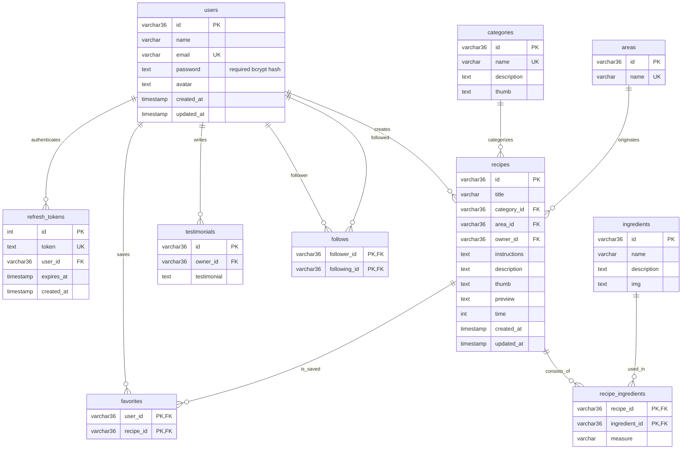

# Foodies — Entity Relationship Diagram

The diagram uses PostgreSQL table and column names from the current schema, created by `20261112010000_init`. Prisma exposes `UserFollow` as `prisma.userFollow` while storing it in `follows`; `Ingredient.desc` is stored in `ingredients.description`.

String IDs and their foreign keys allow 36 characters. Prisma generates UUIDs for new standalone string primary keys; seed explicitly preserves the original 24-character IDs.

`refresh_tokens.user_id` has a non-unique index, so a user can have multiple sessions. Each token has a unique value, required `expires_at`, and automatic `created_at`.

Nullable columns are `users.avatar`, `categories.description`, `categories.thumb`, `ingredients.description`, `ingredients.img`, `recipes.description`, `recipes.thumb`, `recipes.preview`, `recipes.time`, and `recipe_ingredients.measure`. `users.password` is required; seeded profiles receive hashes of discarded random passwords. Refer to [schema.prisma](../prisma/schema.prisma) for authoritative types and optionality.
